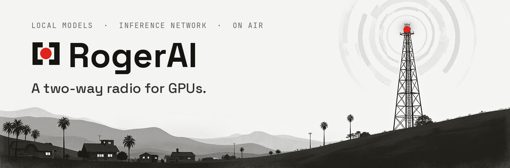

<picture>
  <source media="(prefers-color-scheme: dark)" srcset="assets/banner-dark.png">
  
</picture>

<p align="center">
  <a href="https://rogerai.fm"></a>
  <a href="https://github.com/rogerai-fm/roger/releases/latest"></a>
  <a href="https://github.com/rogerai-fm/roger/releases"></a>
  <a href="https://github.com/rogerai-fm/roger"></a>
  <a href="https://rogerai-fm.github.io/roger/coverage/packages.html"></a>
  <a href="https://apps.apple.com/us/app/rogerai-fm/id6785743752"></a>
</p>

**RogerAI is a two-way radio for GPUs.** People run open models on their own GPUs and go on
air. You tune in and pay by the token. Every response carries a receipt, signed by the
provider and counter-signed by the broker, that traces it back to the model that produced it.
Owners put idle hardware to work. Everyone else gets cheap, varied access to open models.

### Tune in

```sh
curl -fsSL https://rogerai.fm/install.sh | sh
roger            # browse stations, tune in, test, copy the endpoint
roger use <model>  # a local OpenAI-compatible endpoint at 127.0.0.1:4141/v1
```

Also on Homebrew (`brew install rogerai-fm/homebrew-tap/roger`), Scoop and Gentoo. Point any
OpenAI-compatible tool at that endpoint.

### Go on air

```sh
roger share      # finds your local model and puts it on air
```

Your node dials out, so there are no ports to open. It works with Ollama, llama.cpp,
LM Studio, vLLM, Osaurus, Jan, LiteLLM and any other host that serves the OpenAI-compatible API.

### Public repositories

| Repository | What it is |
| --- | --- |
| [**roger**](https://github.com/rogerai-fm/roger) | The `roger` CLI and node agent, run-your-own Tower, the website and the behavior specs. Start here. |
| [homebrew-tap](https://github.com/rogerai-fm/homebrew-tap) | Homebrew tap for macOS and Linux. |
| [scoop-bucket](https://github.com/rogerai-fm/scoop-bucket) | Scoop bucket for Windows. |
| [gentoo-overlay](https://github.com/rogerai-fm/gentoo-overlay) | Gentoo overlay. |
| [llama.cpp](https://github.com/rogerai-fm/llama.cpp) | A llama.cpp fork with the DeepSeek-V4-Flash multi-token-prediction head. GGUFs on [Hugging Face](https://huggingface.co/rogerai-fyi/DeepSeek-V4-Flash-MTP-GGUF). |

### Open where it counts

The node-agent protocol and the usage-receipt SDK are **Apache-2.0**, so anyone can build a
compatible node or check what they were charged without asking us. The rest of `roger` is
source-available under PolyForm Perimeter: free for any use that doesn't compete with the
marketplace, including running your own Tower for your own community.
[LICENSING.md](https://github.com/rogerai-fm/roger/blob/main/LICENSING.md) has the details.

### Get involved

- **Issues and pull requests** are welcome on [roger](https://github.com/rogerai-fm/roger).
  It is published from our private source on every merge. We bring your PR in with your
  authorship kept, then close it once it ships.
- **Security issues:** please report them privately, through GitHub's private vulnerability
  reporting or at security@rogerai.fm. See the [security policy](https://github.com/rogerai-fm/roger/blob/main/SECURITY.md).
- **Read more:** [rogerai.fm](https://rogerai.fm), the [operating manual](https://rogerai.fm/manual.html),
  the [API spec](https://broker.rogerai.fm/openapi.yaml), and the
  [app for iPhone, iPad and Mac](https://apps.apple.com/us/app/rogerai-fm/id6785743752).

<sub>Designed by RogerAI in Orange County, California.</sub>
